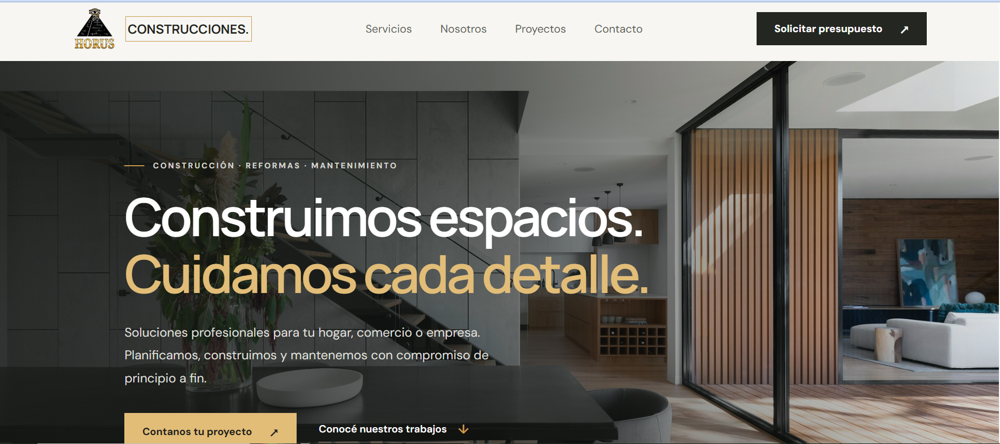
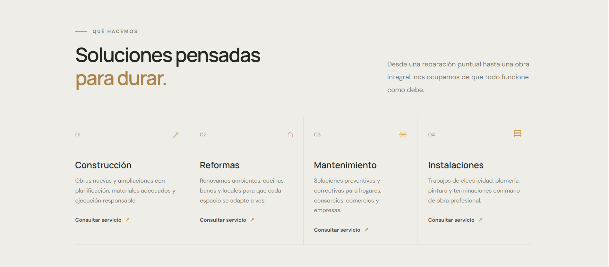
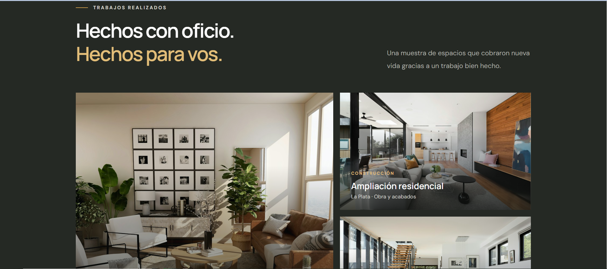
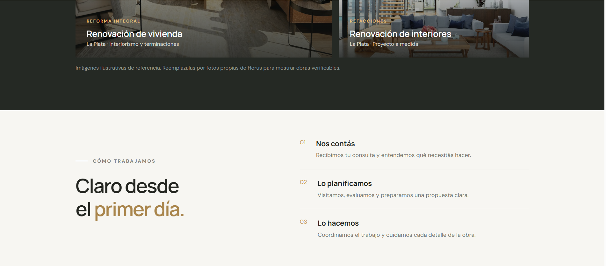
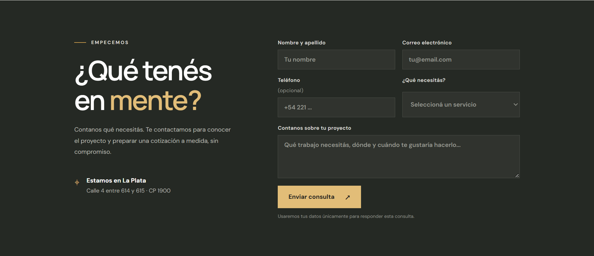
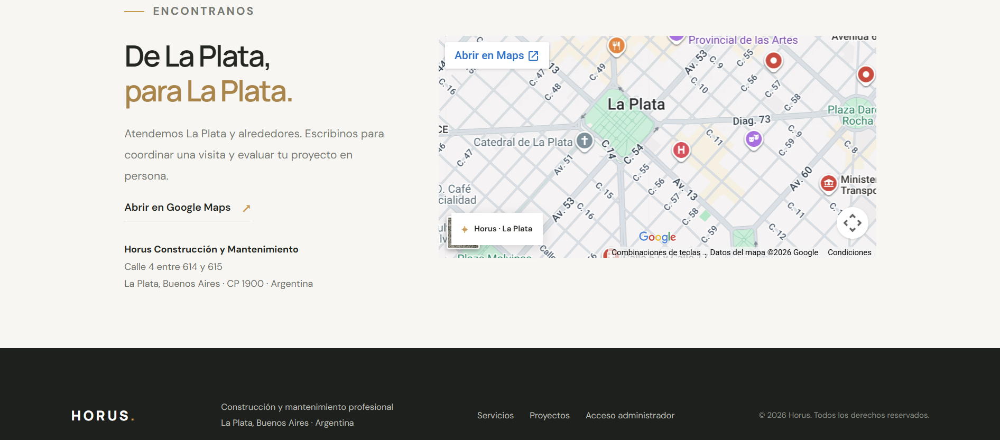
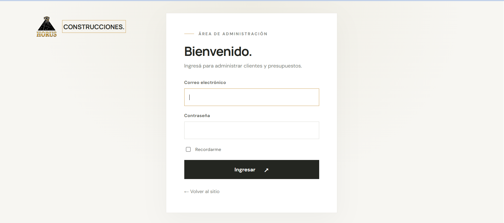
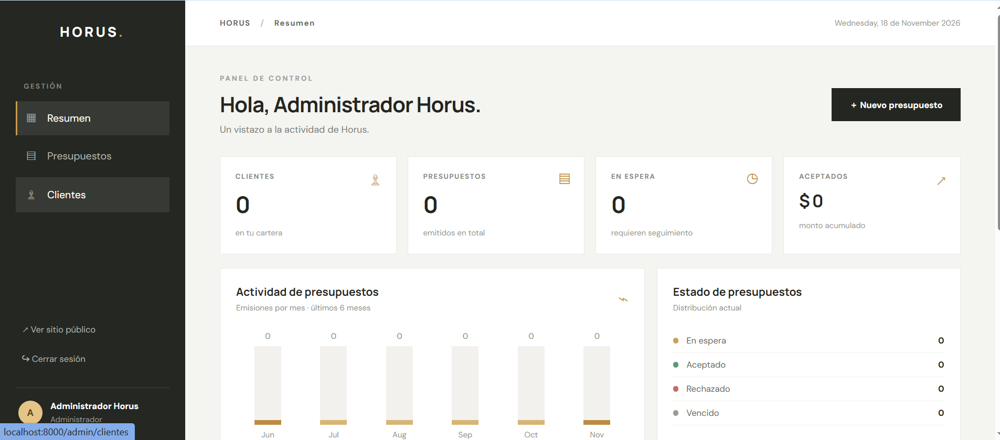
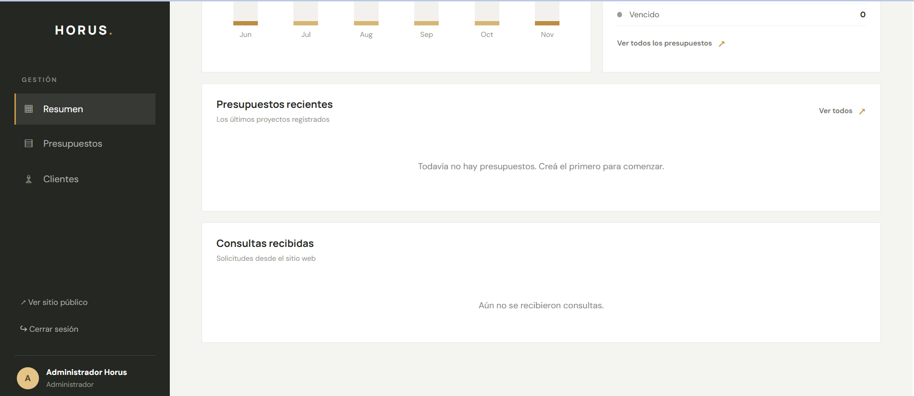
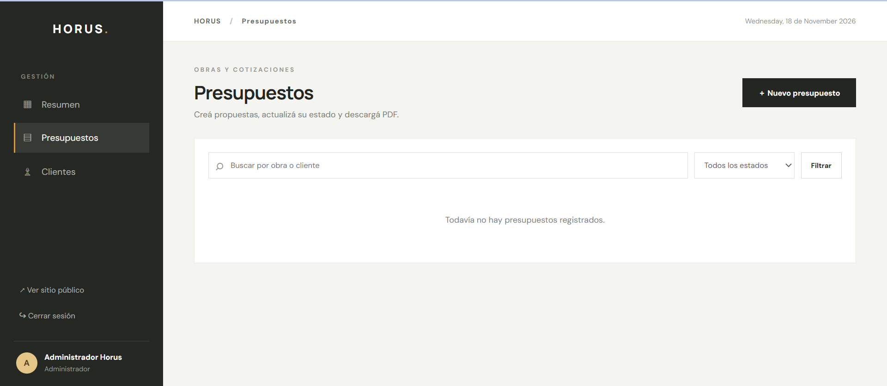

# Horus · Construcción y mantenimiento

Sitio público y panel de gestión desarrollado con Laravel 12, PHP 8.2+ y MariaDB. Incluye consultas de potenciales clientes, administración de clientes y presupuestos, estadísticas y descarga de presupuestos en PDF.
### Home







### Login


### Administrador



### Presupuestos


### Clientes


## Requisitos

- Docker Desktop con el motor iniciado.
- Para conectar la base de datos de XAMPP: XAMPP con MariaDB activo.

## Inicio con Docker y MariaDB

Desde PowerShell, en la carpeta del proyecto:

```powershell
Copy-Item .env.example .env -Force
```

Generá la clave de Laravel. Si tenés PHP y Composer instalados:

```powershell
composer install
php artisan key:generate
```

Si preferís generar la imagen primero, ejecutá `docker compose build` y luego:

```powershell
docker compose run --rm app php artisan key:generate --show
```

Copiá el valor que imprime en `APP_KEY=` dentro de `.env`. Antes de iniciar, cambiá `ADMIN_PASSWORD` en ese archivo.

Iniciá la aplicación y MariaDB:

```powershell
docker compose up --build -d
```

La aplicación ejecuta las migraciones y crea el administrador al iniciar. Abrí:

- Sitio público: <http://localhost:8000>
- Administración: <http://localhost:8000/acceso>
- phpMyAdmin para la base del proyecto: <http://localhost:8080>
- MariaDB desde el host: `127.0.0.1:3307`

Credenciales del panel inicial configuradas en `.env.example`: `admin@horus.local` y `prueba123`. Cambiá la contraseña antes de usar el sistema. Para ver los registros: `docker compose logs -f app`; para detener: `docker compose down`. Los datos de MariaDB quedan en el volumen `horus_mariadb`.

En phpMyAdmin, ingresá con el usuario y la contraseña definidos en `DB_USERNAME` y `DB_PASSWORD` en `.env` (configurados como `horus` / `root`) y elegí la base `horus`. `DB_ROOT_PASSWORD=root` configura la clave del usuario raíz de MariaDB, pero para el uso normal preferí la cuenta `horus`. La contraseña `ADMIN_PASSWORD` es independiente y sirve solo para el panel web. phpMyAdmin se conecta al MariaDB interno de Docker; no uses `127.0.0.1:3307` como servidor dentro del formulario.

## Usar la MariaDB de XAMPP dentro de Docker

1. Iniciá MySQL/MariaDB desde el panel de XAMPP y creá una base y usuario dedicado (reemplazá la contraseña por una propia):

```sql
CREATE DATABASE horus CHARACTER SET utf8mb4 COLLATE utf8mb4_unicode_ci;
CREATE USER 'horus'@'%' IDENTIFIED BY 'una-clave-local-segura';
GRANT ALL PRIVILEGES ON horus.* TO 'horus'@'%';
FLUSH PRIVILEGES;
```

2. En `.env`, configurá `DB_DATABASE=horus`, `DB_USERNAME=horus` y `DB_PASSWORD` con esa misma contraseña. No uses `root` sin contraseña.
3. Si MariaDB solo escucha en `localhost`, configurá el `bind-address` de MariaDB para permitir conexiones desde Docker y habilitá en el firewall de Windows únicamente la red privada/local que uses. No expongas el puerto de MariaDB a redes públicas.
4. Generá una clave de Laravel como en el paso anterior y levantá solo la aplicación:

```powershell
docker compose -f compose.xampp.yaml up --build -d
```

La configuración `compose.xampp.yaml` conecta el contenedor a `host.docker.internal:3306`, ejecuta las migraciones y crea el usuario administrador. Si la cuenta configurada en XAMPP usa un puerto distinto, definí `DB_PORT` en `.env`.

## Ejecutar directamente con XAMPP (sin contenedores)

Instalá Composer, copiá `.env.example` a `.env`, creá la base `horus` en phpMyAdmin y ajustá la conexión a `DB_HOST=127.0.0.1`, `DB_PORT=3306` y las credenciales locales de XAMPP. Luego:

```powershell
composer install
php artisan key:generate
php artisan migrate --seed
php artisan serve
```

Abrí <http://127.0.0.1:8000>.

## Funcionalidades

- Landing de Horus con servicios, galería ilustrativa, formulario de consulta y mapa de Calle 4 entre 614 y 615, La Plata (CP 1900).
- Acceso de administrador sin registro público.
- ABM de clientes.
- Presupuestos con cliente, obra, tareas con importes opcionales de mano de obra por tarea, subtotal de mano de obra calculado automáticamente, materiales, total y vencimiento automático a 21 días. El estado se gestiona internamente y no se incluye en el PDF para el cliente.
- Seguimiento de pagos parciales para presupuestos aceptados: fecha, importe, medio, referencia y notas; el sistema calcula el total abonado y el saldo, evita registrar importes superiores al saldo y permite corregir un pago eliminándolo.
- Descarga de un reporte PDF de pagos independiente del presupuesto, con historial de movimientos, total abonado y saldo pendiente.
- Búsqueda por nombre de cliente u obra y filtro por estado.
- Vista detallada y descarga del presupuesto en PDF.
- Estadísticas de clientes, presupuestos, importes aceptados, estados y actividad mensual.

Las imágenes de la galería son ilustrativas y se cargan desde Unsplash; reemplazalas por fotos propias de Horus antes de publicar el sitio.

## Pruebas

```powershell
php artisan test
```
